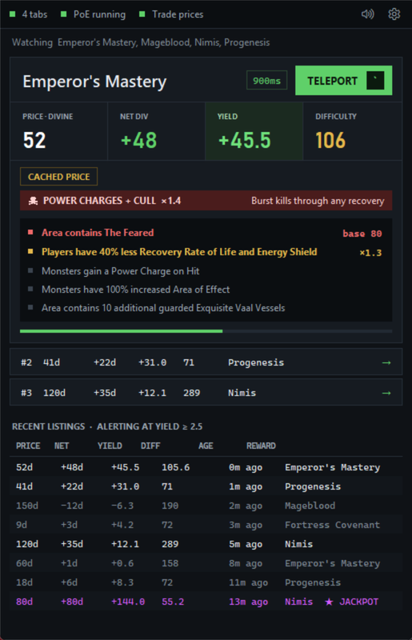
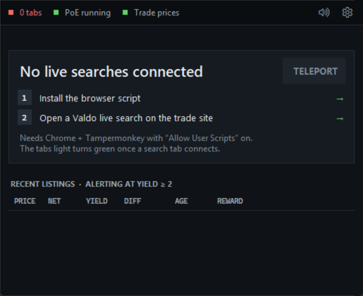
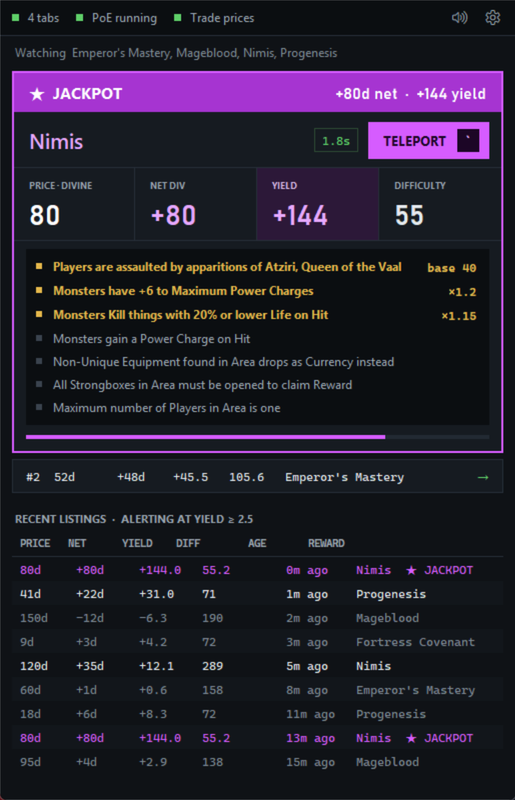
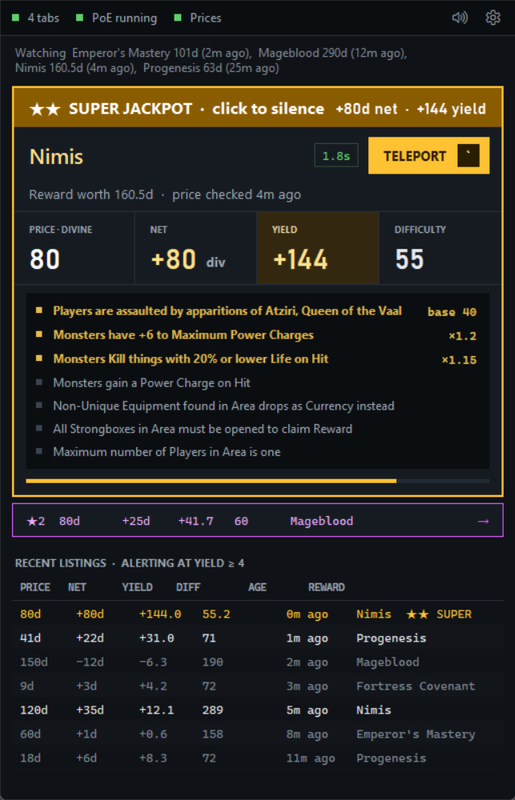
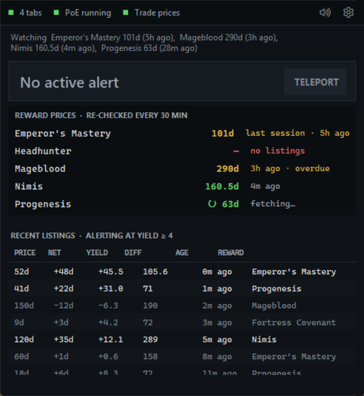

# Valdo Map Sniper

Watches your live searches on the official PoE trade site for Valdo's Puzzle
Box foil maps, works out what each one is actually **worth to you** — profit
against the reward's real market price, divided by how nasty the map is to
run — alerts with sound and an always-on-top overlay, and travels to the
seller's hideout on a single hotkey press. PoE 3.27+ asynchronous trading:
no whispers, you complete the purchase manually at Faustus.



**Trade etiquette / ToS stance (non-negotiable, see CLAUDE.md):** one user
input = one server action. The Travel click fires only in direct response to
your hotkey press or overlay click — never on detection, never queued, never
retried. Listings come from the browser's live-search push, never from
polling the trade API.

---

## The value model — read this first

Everything the app does comes down to one number.

```
EV     =  (1 − fail chance) × market price  −  asking price  −  running cost
SCORE  =  EV  ÷  difficulty  ×  100
```

**EV** (expected value) is what the map leaves you on average: the reward's
market price, minus what you pay, minus the running cost — a flat charge for
the time and losses that running *any* map incurs (see below). Mods that can
make the map fail scale the market price down by the chance it succeeds
([Failure risks](#failure-risks)), so EV is an average over many buys, not a
guaranteed profit.

**SCORE** is that EV per unit of difficulty. Since EV is already
time-adjusted and difficulty measures how nasty the map is to run, score is
what the map pays you **per unit of pain**. An alert fires when it clears
your threshold and the EV is worth the trip:

```
alert  ⟺  SCORE  ≥  thresholds.min_yield   (4 by default)
       and EV     ≥  thresholds.min_net     (7 divines by default)
```

The EV floor is there because an easy map can reach a high score on a
profit too small to travel for. Set it to 0 to let score alone decide.

Why a rate rather than raw surplus: a clean 25-difficulty map at +20 div and
a Feared + VOID nightmare at +50 div are not the same trade. The second pays
more and is worth less. Score says so, and it is what the hotkey ranks on
when several maps are alerting at once.

The threshold is in those same units, so it reads directly: **"a
100-difficulty map must be expected to make this much."** A 200-difficulty
map needs twice as much; a 50-difficulty map half.

(Earlier versions called these NET and YIELD. The config keys keep their
old names — `min_net`, `min_yield`, `jackpot_min_net`, … — so existing
settings keep working.)

### Difficulty

Each mod on the map contributes, via `mod_scoring` in `config.yaml`:

- **Base rules** set a floor — `The Feared: min_base 100` means any map with
  The Feared starts at 100 difficulty. The **highest** base wins; they don't
  add up.
- **Multipliers** scale the result — `100% Delirious: ×2.0`. These all
  multiply together.
- **Pairings** multiply on top again, for combinations that are worse than
  the sum of their parts (below).

So `difficulty = max(base_default, highest min_base) × every multiplier ×
every pairing`.

### The running cost

`thresholds.running_cost` (default **1** divine) is what running a map costs
you — the time it takes plus what you lose reselling — and it comes off every
listing before anything else looks at it. Running any map costs you something, so
an easy map with a 0.5 div margin is not actually worth doing. It is
subtracted at the source: the EV on screen, the score, the alert cutoff and
the hotkey's ranking all already account for it.

### Deadly pairings

Some mod combinations aren't "harder" — they're unrunnable. `mod_pairings`
catches these, multiplies the difficulty hard, and shows a red banner with a
note saying what actually goes wrong:

| Pairing | × | Why |
|---|---|---|
| No damage + fatal timer | 10 | Impossible unless DPS-check build |
| Delirium + fatal timer | 10 | Impossible unless DPS-check build |
| Blight + melee-range only | 2 | Bricks the CC tower strategy |
| The Feared + void | 2 | Desolation can always kill the player no matter how tanky they are |
| Increasingly lethal + void | 2 | Damage keeps ramping where dying deletes the character |
| Instability + void | 2 | Unstable players detonate where dying deletes the character |
| Legion + melee-range only | 2 | Makes the Legion much harder to complete in the time limit |
| Legion + less damage | 2 | Makes the Legion much harder to complete in the time limit |
| 10% less damage + delirium | 2 | Takes too long to clear unless dps build |
| Sirus storms + no travel skills | 1.5 | Slowed with no travel skills, so the storms are hard to escape |
| Ultimatum + no block | 4 | Ultimatum waves hit hard when you cannot block |

These stack multiplicatively, so a map with two 10× pairings lands in the
hundreds of thousands of difficulty and will simply never alert — which is
the point. Multipliers are editable in the ⚙ panel; the match patterns live
in `config.yaml`.

### Failure risks

Some mods don't make a map harder, they make it **fail**, and a failed map
loses everything you paid for it. `mod_risks` gives each one a chance of
failing, which is what makes EV an *expected* value:

```
EV  =  (1 − fail chance) × market price  −  asking price  −  running cost
```

| Risk | Fail chance | Why |
|---|---|---|
| Ultimatum | 10% | Can brick the map even without penalties |
| Ultimatum + less damage or delirium | 25% (replaces the 10%) | Protect the Altar, if it rolls, is likely to fail |
| Ultimatum + fatal timer | 80% (replaces both above) | The fatal timer runs out during the Ultimatum waves |
| Breach | 10% | A Breach can fail to stabilise |
| Breach + less damage or delirium | 100% (replaces the 10%) | Breaches can't be stabilised: unclearable |
| Blight | 10% | Monsters can leak through the towers |
| Blight + rares with extra modifiers | 50% (replaces the 10%) | Buffed rares leak through the towers |
| Legion | 10% | The Legion encounter can fail |
| Legion + melee-range only | 25% (replaces the 10%) | Packs fought point-blank often outlast the encounter |
| Ruinous Ghosts | 10% | Reaching seven Ruin loses the reward |
| Bismuth | 30% | Bismuth maps bug out and fail |
| 1 portal | 15% | One death ends the map |

Every league mechanic (Blight, Legion, Breach, Ultimatum) carries at least a
10% chance of failing, however easy the rest of the map is.

A 200d reward listed at 100d with Bismuth on it has an EV of 0.7 × 200 − 100 =
**+40d**, not +100d. Several risks on one map combine as independent chances
(25% and 30% together is 47.5%, not 55%). A 100% risk can never come out
positive, so an unclearable Breach never alerts at any price.

Because score, the alert cutoff, jackpots and the hotkey's ranking are all
built on EV, they all account for the risk. On the overlay each risk gets an
amber row with its chance, and a line says what it cost (*"EV counts a 48%
chance of failing (−95d of the reward's value)"*). Feed and runner-up rows carry a `⚠30%` marker.

**Adjust the chances in the ⚙ panel** under *Map scoring → Failure risks* (in percent,
applied live and saved); 0 switches a risk off. To add a new one, copy an
entry in `mod_risks` in `config.yaml`. An `unless:` pattern makes a general
risk step aside for a more specific one, which is how plain Ultimatum (10%),
Ultimatum with less damage or delirium (25%) and Ultimatum with a fatal timer
(80%) avoid stacking.

**The ⚙ panel is in four tabs**: *Alerts* (alert and jackpot bars), *Map
scoring* (failure risks, deadly pairings, difficulty rules), *Searches*
(live-search presets, reward price pins) and *General* (hotkey, sound,
files). Every change applies and saves as you type. The **search box** at
the top looks through all four tabs at once: type part of a mod or setting
name (`ghost`, `jackpot`) to see just those rows, or a section name (`risk`,
`pairing`) to see all of it; each result says which tab it lives on. Esc
clears it. Difficulty rules are listed alphabetically.

---

## Setup

You need Windows, Chrome and Path of Exile. About five minutes:

1. **Download `ValdoSniper.exe`** from the
   [latest release](https://github.com/Kuderic/PoEValdoAssistant/releases/latest).
   Nothing else to install: no Python, no setup.
2. **Put it anywhere you can write to**, `Downloads` included (just not
   `Program Files`: it updates itself in place). Your settings, price cache
   and logs go to `%LOCALAPPDATA%\ValdoSniper`, not next to the exe; ⚙
   Settings → **General** → **Open** shows that folder.
3. **Double-click it.** Windows may say *"Windows protected your PC"* the
   first time: click **More info → Run anyway** (or right-click the exe →
   **Properties** → tick **Unblock** first). If Defender quarantines it, see
   Troubleshooting. The overlay opens with a setup guide:

   

4. **Install [Tampermonkey](https://www.tampermonkey.net/)** from the Chrome
   Web Store.
5. **Enable user scripts for Tampermonkey (required).** Chrome blocks every
   userscript until you allow it, and Tampermonkey stays installed but
   silently runs nothing:
   1. Open `chrome://extensions` in the address bar.
   2. Find **Tampermonkey** and click **Details**.
   3. Turn on **Allow User Scripts**.

   On older Chrome, before version 138, there is no such toggle. Turn on
   **Developer mode** (top-right of `chrome://extensions`) instead.
   To check it worked, open the Tampermonkey dashboard. It shows no warning
   about user scripts being disabled. Reload any trade tabs that were already
   open.
6. **Click "Install the browser script"** in the overlay and press
   **Install** on the Tampermonkey page that opens. (The app serves it
   itself, at `http://127.0.0.1:8765/valdo-sniper.user.js`.)
7. **Click "Open the High profit live searches"** in the overlay. It opens
   six live searches in Chrome, one tab per reward: Headhunter, Mageblood,
   Nimis, Progenesis, Sublime Vision and Wine of the Prophet. Each tab
   connects on its own, and the status strip turns green:
   `6 tabs · PoE running · Prices`. If it stays at `0 tabs`, step 5 is the
   usual cause. Log in to the trade site first if Chrome isn't already: the
   live search and the travel button both need it.

   You can instead build your own searches. Click *or build your own search
   on the trade site*, set up a foil Valdo map search, press **Search**, then
   **Activate Live Search**. To reopen the preset later (it skips searches
   that are already open), use ⚙ Settings → **Searches** → **Open 6
   tabs**.

Run PoE in **windowed fullscreen**, not exclusive fullscreen, or the overlay
can't stay on top. Sound works either way.

### Updates

**The exe updates itself.** Every hour it asks GitHub whether a newer
release is out. If one is, a green bar at the top of the overlay says so,
and it downloads it in the background and checks it against the checksum
GitHub publishes. Then the bar (and a pill in the status strip) says
**UPDATE v1.2.0 READY**. Click it to restart into the new
version (a few seconds; open trade tabs reconnect by themselves), or ignore
it and the update installs the next time you start Valdo Sniper. It never
restarts by itself, so it can't interrupt a snipe. After the restart the
strip says **✓ updated to v1.2.0** for a couple of minutes; click it to see
what changed.

Updates keep your settings: everything you change in the ⚙ panel is saved
to `scoring_overrides.yaml` in `%LOCALAPPDATA%\ValdoSniper`, and your
`config.yaml`, price cache, logs and `.env` live there too. (Versions before
1.3.4 kept them next to the exe; the first start of a newer one moves them
over by itself.) New default rules (pairings, risks, mod scores) come
with each update.

Tampermonkey picks up the new browser script by itself. If a tab is still on
an old one, the tabs light turns red with *update script*, and clicking it
reinstalls. Hard-reload open trade tabs afterwards, since a tab keeps
running the script it loaded with.

To switch it off, put this in your `config.yaml` (⚙ → **General** → **Open**):

```yaml
updates:
  auto_download: false   # only announce new versions
  # enabled: false       # don't even check
```

### Your own config.yaml

On first start the exe writes a `config.yaml`, all comments, to
`%LOCALAPPDATA%\ValdoSniper` (⚙ Settings → **General** → **Open**).
Anything you put there overrides the built-in defaults **key by key**, so it
only needs what you change; the rest keeps tracking the defaults as they
update. The full list of settings is the
[`config.yaml` in this repo](config.yaml). A list (like `mod_pairings`)
replaces the default list completely rather than adding to it.

### Running from source instead

For development, or if you'd rather not run an exe:

1. Install **Python 3.12 or newer** from
   [python.org](https://www.python.org/downloads/) (tick *"Add python.exe to
   PATH"*), or `winget install -e --id Python.Python.3.12`.
2. Get this folder: *Code → Download ZIP*, or
   `git clone https://github.com/Kuderic/PoEValdoAssistant.git`.
3. Double-click **`start.bat`**. The first run sets up a private Python
   environment (about 20 seconds); after that it starts instantly.

Here `config.yaml` in the folder is the whole config. A source checkout
can't replace itself, so a green bar at the top of the overlay only says a
new version is out:
update with `git pull` (or download the ZIP again) and restart `start.bat`.

`start.bat` passes arguments through: `start.bat --headless` runs without
the overlay, `start.bat --config other.yaml` uses another config. If you
manage Python yourself, `pip install -e .` and `python -m sniper` work too.
Developer extras: `pip install -e .[dev]` (pytest, ruff, PyInstaller).

### Releasing a new version (maintainer)

1. Bump `__version__` in `sniper/__init__.py`, commit and push.
2. `git tag v1.2.0 && git push origin v1.2.0`.

The **Release** GitHub Action runs the tests, builds `ValdoSniper.exe`
(refusing if the tag and `__version__` disagree), proves the exe works with
`--self-check`, and publishes it as a release. Every installed copy picks it
up within the hour: a green bar at the top of its overlay announces it. To build locally: `python tools/build_exe.py`, which
writes `dist/ValdoSniper.exe`.

#### Code signing (maintainer)

An unsigned exe gets SmartScreen's *"Windows protected your PC"* on every
new release and is a regular Defender false positive (`Bearfoos!ml`). The
Release action signs the exe with **Azure Artifact Signing** (formerly
Trusted Signing) once it is configured; until then it publishes unsigned
with a warning. Once configured, a release whose signing fails is not
published. One-time setup (individual validation needs a US or Canadian
government ID; about $10/month for the Basic plan):

1. **Azure:** in a pay-as-you-go subscription, *Subscriptions → Resource
   providers*, register **Microsoft.CodeSigning**.
2. **Create an Artifact Signing account** (Basic). Its region sets the
   endpoint, e.g. East US = `https://eus.codesigning.azure.net/`.
3. On the account's **Access control (IAM)**, give yourself **Artifact
   Signing Identity Verifier**.
4. **Identity validations → New → Public → Individual.** Your legal name
   becomes the publisher shown on the exe. Takes hours to a few days.
5. **Certificate profiles → Create → Public Trust**, using that validation.
6. **Microsoft Entra ID → App registrations → New** (e.g.
   `valdo-sniper-release`). Under *Certificates & secrets → Federated
   credentials → Add*: scenario *GitHub Actions*, this repo, entity type
   **Environment**, name **`release`**.
7. On the signing account's **IAM**, give that app **Artifact Signing
   Certificate Profile Signer**.
8. **GitHub → Settings → Secrets and variables → Actions**, at repository
   level:
   - secrets `AZURE_CLIENT_ID` (the app's client ID), `AZURE_TENANT_ID`,
     `AZURE_SUBSCRIPTION_ID`;
   - variables `ARTIFACT_SIGNING_ENDPOINT`, `ARTIFACT_SIGNING_ACCOUNT`,
     `ARTIFACT_SIGNING_PROFILE`.

The next tag is signed. The action checks the signature and its timestamp,
and re-runs `--self-check` on the signed exe before publishing. SmartScreen
reputation still builds with downloads, so the warning can linger briefly
after the first signed release.

---

## Reading an alert

See the screenshot at the top: the reward name, the latency badge and the
**TELEPORT** button (with your hotkey on it), what the reward is worth, then
the four numbers, then warnings, then the map's mods.

**Hover anything to see what it means.** Every part of the overlay has an
explanation that pops up instantly: the status pills, the latency badge,
each of the four numbers, the price markers, ☠ and ⚠ rows, the jackpot
banner, the countdown bar and the history's column headers. The four numbers
also work their sum through for the listing on screen, e.g. EV shows
`101 worth − 52 price − 1 running = +48.0d` and DIFFICULTY shows
`base 80 × 1.3 × 1.4 = 146`.

| Element | What it tells you |
|---|---|
| **Map: Strand · Reward worth …** | The map's layout (its Map Area), then what the map's reward unique sells for and when that price was last checked on the trade site (`price checked 4m ago`). A price from anywhere else says so (last session / poe.ninja estimate / your price). EV is worked out from it |
| **Stash spot** | Where the item sits in the seller's tab: a mini grid with its cell marked, the rough area (`bottom right`), the tab name and the exact `col, row`. Read it while the hideout loads and the click at Faustus is already aimed. Shown for listings caught from the network (almost all of them). The trade site doesn't give the tab size, so a 12×12 tab is assumed unless the position only fits a quad tab |
| **PRICE** | What you pay, and in which currency. Turns red on a currency mismatch (the classic "20 exalted, not 20 divine" bait) — a full-width banner also appears. Chaos and alchemy prices are never flagged |
| **EV** | Expected value: reward value (scaled by the chance the map succeeds) − asking price − the running cost, in divine (`+48 div`). What the map leaves you on average |
| **SCORE** | The decision number, in the tinted cell: EV ÷ difficulty × 100, i.e. profit per unit of pain. It decides alerts and the hotkey's pick, so an easy map with modest profit can beat a brutal one. Green means it clears your threshold |
| **DIFFICULTY** | How hard the mods make the map; 100 is a typical map. The toughest encounter's base (or the clean-map default) × every dangerous mod and pairing. Plain ≤100, amber >100, red >300 |
| **latency badge** | The delay between the seller listing the map (the trade site's own index time) and your Chrome tab receiving it from the live search: the head start every other sniper had. Not your reaction time. Green under 2s, red past 5s. A busy tab creeps up over hours; when one does, an amber bar under the status strip says `⟳ RELOAD Mageblood (+2.7s lag)` (or whichever tab) |
| **☠ rows** | Deadly pairings, with the reason |
| **Mod list** | Each mod with its contribution (`base 120`, `×2.5`), marked red/amber by severity, modifiers right-aligned. Biggest multiplier at the top, down to the mods that add nothing; the history's hover lists them the same way |

**Use latency to decide whether to bother.** From this app's own logs:
travels clicked within ~2s of detection still lost the item 26% of the time;
4–10s lost 52%. A red latency means someone almost certainly has it already.

Other markers you may see: `ESTIMATED PRICE` (priced from poe.ninja's
median, which is inaccurate for foil Valdos), `CACHED PRICE` (last
session's trade price, refresh pending), `YOUR PRICE` (a price you pinned in
the ⚙ panel). The first two disappear once a fresh trade average lands.

**The sounds are short on purpose.** Every alert sound is built in and
at full volume within a few milliseconds, so nothing is still playing when
you react: press on the sound, don't wait for it to end. Pick the style in
**⚙ Settings → General → Alert sounds** (clicking one plays it):
**Short** blips, a **Soft jingle** (gentle chimes, the default), or
**Windows** for the longer Windows sounds (Exclamation 1.4 s, tada 1.6 s,
alarms ~4 s). Every alert plays once. Jackpots and super jackpots play
their own fanfare, and the style changes those too: in **Short** a bright
rising run that rings out into a chord, in **Soft jingle** the same run
rung as chimes, in **Windows** the Windows alarms. Each fanfare is about a
second long, starts just as fast as the blips and can't be mistaken for an
ordinary alert. The two buttons under Alert sounds play them and say which
one you'll hear (**▶ Short fanfare**, **▶ Soft jingle fanfare**, **▶
Windows alarm**, or **▶ your .wav**). Each is as loud as the Windows sound it
replaced, so the volume slider means what it did. A `.wav` of your own in
`alerts.sound` / `generic_sound` / `jackpot_sound` / `super_jackpot_sound`
always wins.

**Acting on it:** press the hotkey (default `` ` ``) to travel to the best
alert by score, click the **TELEPORT** button, or click any row — including
a grayed-out one in the history — to travel to that specific listing. All
require PoE to be running; the hotkey is deliberately inert otherwise. After
traveling, the map's mods stay pinned for ~10s so you can read them during
the loading screen, then you buy manually at Faustus. The hotkey works even
while you hold Shift, Ctrl or another key, and holding it down counts as one
press.

**Keep it minimized if you like (alert pop-up):** with the window
minimized, on either monitor, an alert brings it back showing **only the
alert card** (the status strip and the card, nothing below), **80%
opaque**, without taking the keyboard from the game. Press the **teleport
hotkey** and the whole window opens, solid, as the travel goes out (a
TELEPORT click or a click anywhere on the pop-up opens it too). Rather not
travel? Press **Esc** and it minimizes again; it comes back full size the
next time you open it yourself. Esc still reaches the game as usual, and it
only means anything to the overlay while a pop-up is showing. Turn it off,
change the opacity or pick another close key in **⚙ Settings → General →
Alert pop-up**.

**Travel again:** if a teleport didn't take, click the same listing again
(the pinned card or its history row) after a couple of seconds. The trade
tab refreshes that listing — the site locks a used Travel button until then
— and clicks Travel once. Each click is one travel; nothing repeats on its
own.

**Shop marker:** once a travel lands, the item's cell is outlined over the
game as the seller's hideout loads, so you can click it the moment the shop
opens. The box is coloured by the alert's tier, as in the app: green for a
normal alert, magenta for a jackpot, gold for a super jackpot, cyan for a
super mega jackpot. Right on top of the box is its label: the reward and
tab, then price, EV and difficulty (`Nimis · tab "7"` /
`80d · +42d EV · diff 144`).
**The same seller's other alerts are marked too**, each box numbered
(1 ★ = the one you traveled to), since two of one tier share a colour. While
two or more boxes are drawn, the app labels the same listings to match: the
alert card's stash line reads **Box N** in that box's colour, the runner-up
bands carry a coloured number, and the recent listings show `▣ box N`.
Marked:
any of theirs that alerted in the last 3 minutes, plus any that alert while
you're on the way or in the hideout, which are added to the marker as they
arrive. It goes away when you leave the hideout or after 60s (an item added
late stays up at least 20s). It
only draws: clicks pass straight through to the game and it never takes the
keyboard. It needs **windowed** or **borderless fullscreen** PoE (exclusive
fullscreen hides every overlay). The timing comes from PoE's own log
(`logs/LatestClient.txt` in the game folder, found automatically); without
it the marker goes up as soon as the travel lands.

The grid position was measured at 2560×1440 and scales to other
resolutions. If the box is off on yours: open any Merchant window in game,
then **⚙ Settings → General → Shop marker → Calibrate…** and click the
item grid's top-left and bottom-right corners (Enter saves). **Show grid**
draws the grid over the game to check it, and the four numbers there can be
typed in by hand.

---

## Sniping things that aren't Valdo maps

Open a live search for **anything** — a rare with the stats you want, a
unique under a price — and the app alerts on it the moment it lists, with
the same hotkey travel.

Nothing to configure. A tab whose search has no Valdo map-reward filter is
detected automatically and switched to an always-alert lane: no reference
price, no difficulty score, no threshold. Your search already says what you
want and what you will pay, so the app's only job is to put it on screen
fast and let you travel.

```
⚡ LIVE SEARCH
Vermillion Ring                            ⚡ TELEPORT  [ ` ]   latency 1.4s
PRICE DIVINE
12
Doom Coil  ·  Serpent#1234
+45 to maximum Life
+38% to Fire Resistance
```

EV, Score and difficulty are blank because they have no meaning here —
there is no market average to profit against, and the mod scoring reads
*map* modifiers, so a ring's stats would invent a difficulty out of nothing.
These rows show `[search]` in the history list.

Two things worth knowing:

- **These never touch the pricing budget.** A generic tab registers no
  reward, so it costs zero trade-API requests — open as many as you like
  without pushing pricing closer to a rate-limit lockout. (Your browser's
  own fetches still count; see Maintenance.)
- **A non-Valdo hit takes the top of the overlay** above every ordinary
  Valdo alert, so the hotkey travels to it. Only a jackpot or super jackpot
  outranks it. Several of them rank newest first. Valdo alerts still rank
  among themselves by score below it, so a session with no generic tabs
  open behaves exactly as before.

**These get their own sound.** A non-Valdo hit plays two rising notes
instead of the usual single blip, so you can tell one apart from routine
Valdo traffic without looking at the screen. The one exception is a
jackpot alarm still playing: a hit arriving during it stays quiet rather
than cut it off, and waits just below the jackpot. Point
`alerts.generic_sound` at
any `.wav` to change it; `alerts.volume` scales both. Keep any replacement
short — alerts expire in seconds and the next one cancels this one, so a
5-second alarm would still be playing after you'd already travelled.

If a search is too broad it will alert constantly; tighten the filters on
the trade site rather than in the app.

### Alert tiers you don't want

**⚙ Settings → Alerts → Alert tiers** has a switch per tier: **Normal**,
**Jackpot**, **Super** and **Super mega**. Switch one off and its listings
stop alerting: no alert card, sound, pop-up or hotkey target. They still
show in Recent listings, greyed out with `[off]`, and clicking one still
travels. Live searches outside Valdo aren't a tier and always alert.
(`alerts.muted_tiers` in config.yaml.)

### Jackpots

A Valdo listing that is **both** big money and cheap to run (EV ≥ 25d
**and** score ≥ 12 by default) is a jackpot:



- a magenta **★ JACKPOT** banner and frame, with the name, EV and score
  in magenta and a magenta TELEPORT button;
- it takes the hotkey's top slot over anything else, non-Valdo hits included;
- it stays magenta with `★ JACKPOT` in the live feed, so one you missed is
  obvious later.

It also **plays a fanfare once** (a rising run into a ringing chord, about
a second, at the volume slider) instead of the usual alert sound. An ordinary alert
arriving while it plays stays quiet rather than cut it off. If you travel
to the jackpot and it turns out to be sold already, the alarm stops. The
speaker icon mutes everything. The overlay is never pulled to the front. Set
`alerts.jackpot_alarm: false` to have jackpots play the ordinary alert sound
instead.

Tune the bars in the ⚙ panel's **Alerts** tab (applied live and saved), or
with `alerts.jackpot_min_net` / `jackpot_min_yield` in `config.yaml`. A
currency mismatch is never a jackpot. A listing priced in chaos or alchemy is
not a mismatch at all: it can only mean a cheaper map, so it gets no warning
and can be a jackpot or super jackpot like a divine one.

#### Super jackpots

The tier above: a jackpot that **also** clears higher bars (EV ≥ 45d **and**
score ≥ 15 by default) is a super jackpot:



- a gold **★★ SUPER JACKPOT** banner, frame and TELEPORT button;
- its own, bigger fanfare (a two-octave run into a higher chord, just over
  a second), so you can tell the tiers apart by ear;
- it outranks a jackpot for the hotkey;
- `★★ SUPER` in gold in the live feed.

Tune the bars in the ⚙ panel's **Alerts** tab (the *Super jackpot* row) or with `alerts.super_jackpot_min_net` / `super_jackpot_min_yield`.

#### Super mega jackpots

The top tier: a super jackpot that **also** clears EV ≥ 80d **and** score
≥ 20 (by default) is a super mega jackpot:

- an electric cyan **★★★ SUPER MEGA JACKPOT** banner, frame and TELEPORT
  button;
- its own, biggest fanfare (a fast three-octave run into a big high chord,
  about 1.3 seconds), different again from the other two tiers;
- it outranks everything for the hotkey, super jackpots included;
- `★★★ MEGA` in cyan in the live feed.

Tune the bars in the ⚙ panel's **Alerts** tab (the *Super mega jackpot*
row) or with `alerts.mega_jackpot_min_net` / `mega_jackpot_min_yield`.

## Tuning it to actually make money

The defaults are a starting point, not an answer. The app logs every listing
and every decision, so tune against your own data rather than guessing.

**Start loose, then tighten.** Set `min_yield` low (1–2), run a
session, then look at what you'd have bought:

```
grep '"event": "decision"' logs/sniper-*.jsonl
```

Every entry carries `net_div`, `difficulty`, `required_net_div` and the
matched `difficulty_mods`. If maps you would never run are alerting, their
difficulty is scored too low — raise those rules. If you're seeing nothing,
the threshold is too high or your mod rules are too harsh.

**Score difficulty for *your* build, not in the abstract.** This is where the
profit is. A map that's trivial for you and brutal for everyone else is
underpriced by the market and is exactly what you want to be buying. Drop the
multipliers on mods you don't care about and raise the ones that actually
stop you. The ⚙ panel edits every rule live and saves to
`scoring_overrides.yaml`, so you can tune mid-session without a restart.

**Add pairings as you learn them.** Any combination that wastes your time is
worth encoding once, with a note, so you never have to re-derive it at 2am
with a 16-second alert timer running.

**Raise the running cost if you're churning low-value maps.** At 1 divine you'll
still see thin margins on cheap rewards; at 3–5 you only see trades worth
stopping for.

**Per-reward thresholds** (`thresholds.per_map`) let you demand more from
contested rewards. Nimis and Svalinn in this app's logs sold out from under a
travel click 51% and 40% of the time respectively; Sublime Vision only 4%. If
a reward is a bloodbath, either demand a much better price or don't search
for it.

**Manual price overrides** (`prices`) always win over any fetched price — use
them when you know better than the market average, e.g. right after a patch.

### Config quick reference

| Key | Does |
|---|---|
| `thresholds.min_yield` | Minimum SCORE to alert (4), also in the ⚙ panel |
| `thresholds.min_net` | Minimum EV to alert, in divines (7), also in the ⚙ panel. 0 turns it off |
| `thresholds.running_cost` | Divine cost of running a map, off every listing |
| `thresholds.void_min_net` | Minimum EV for a map with the VOID mod to alert, in divines (0 = same bars as any map), also in the ⚙ panel |
| `thresholds.per_map` | Per-reward threshold overrides |
| `mod_scoring.base_default` | Difficulty of a clean, unmodded map |
| `mod_scoring.rules` | Per-mod `min_base` / `multiplier`, optional `warning` |
| `mod_pairings` | Deadly combinations: `multiplier` + `note` |
| `mod_risks` | Chance (0–1) a mod combination makes the map fail; it scales EV down by the chance of success. Chances also in the ⚙ panel |
| `mod_warnings` | `block` rules — logged, never alerted, at any price |
| `hotkey.combo` / `.consume` | Travel key; `all` clears every alert per press, `top` keeps runners-up (a *failed* travel gives them back either way) |
| `hotkey.raise_overlay` | `true` (default): every press also brings the overlay to the front (restoring it if minimized) without taking focus from the game. `false` leaves it where it is. Also a toggle in ⚙ Settings |
| `popup.enabled` / `.opacity` / `.dismiss_key` | Alert pop-up while minimized (on) / its opacity (0.8, from 0.2) / the key that minimizes it again (`esc`; empty = none). All three also in ⚙ Settings → General |
| `shop_overlay.enabled` / `.seconds` | Outline the item in Faustus' shop after a travel (on) / for how long (60s). Toggle and calibration also in ⚙ Settings → General |
| `shop_overlay.grid` / `.client_log` | The Merchant grid measured at some resolution (default: 2560×1440) / PoE's log path when it isn't found automatically |
| `alerts.expiry_seconds` | How long an alert stays travel-able (16) |
| `alerts.volume` | 0.0–1.0, also in the ⚙ panel |
| `alerts.sound_style` | `short`: built-in 0.1–0.2 s blips. `jingle` (default): soft 0.35–0.4 s chimes. Jackpots get a ~1 s fanfare in each (bright / chimed / the Windows alarm). `windows`: the longer Windows sounds. Also in ⚙ Settings → General. Your own `.wav` settings win either way |
| `alerts.jackpot_min_net` / `jackpot_min_yield` | Jackpot bars (15 / 8), also in the ⚙ panel |
| `alerts.jackpot_alarm` / `jackpot_sound` | Play an alarm on a jackpot (once; a super jackpot its own alarm, once) instead of the ordinary sound / its .wav |
| `alerts.super_jackpot_min_net` / `super_jackpot_min_yield` / `super_jackpot_sound` | Super jackpot bars (30 / 10), also in the ⚙ panel / its alarm .wav |
| `alerts.mega_jackpot_min_net` / `mega_jackpot_min_yield` / `mega_jackpot_sound` | Super mega jackpot bars (40 / 20), also in the ⚙ panel / its own .wav |
| `trade_pricing.cache_max_age_minutes` | How stale a restored price may be (720) |
| `updates.auto_download` / `enabled` | Download new releases in the background (on) / check for them at all (on) |

---

## How pricing works

Reward prices come from the **official trade API**: the cheapest unidentified
copies of each reward's unique, outlier-filtered and averaged. poe.ninja's
per-map medians proved inaccurate for foil Valdos and are only a fallback;
poe.ninja is still used for currency rates and to resolve `league: auto`.

- **Startup is not blind.** Last session's prices are restored from
  `price_cache.json`, so the first listing is judged immediately while a
  refresh runs behind it. Anything older than `cache_max_age_minutes` is
  discarded as too stale to trade on.
- **Without a cache**, listings for an unpriced reward are *held back* rather
  than judged against a bad price — the overlay shows `Calculating prices…`
  with a per-reward panel of what's done, in flight, and queued.
- **Rate limits are respected from the API's own headers**, so pacing adapts
  instead of guessing. If you get limited anyway, the header pill turns red
  (`RATE LIMITED 47s`) and unpriced rewards show as `Est. prices 5/8`.
- **Check a price before an alert arrives.** Whenever no alert is showing,
  the card lists every reward you're searching with its price, how long ago
  it was fetched and where it came from:

  

  Green is a fresh trade price. Amber means check it first: overdue for a
  re-check, last session's price, a poe.ninja estimate, or one you pinned.
  Red means no buyable listings. While an alert is up, its card says what
  its own reward is worth and when that was checked. Hovering a row in the
  history also shows its reward's current price and age.
- Prices refresh every `refresh_minutes` (30 by default); a `↻` before a
  price marks the reward being recalculated, and the `↻` at the end of a row
  re-prices it now. Every
  active reward re-prices each cycle, so lowering this multiplies the request
  rate by however many live searches you have open — 10 minutes was enough to
  earn a 30-minute API backoff.

- **A price that's plainly wrong is fixable on the spot.** ⚙ Settings →
  **Searches** → **Reward prices** pins your own figure (in divine) for any active
  reward; blank means automatic. It beats every other source, applies to
  listings from then on, and shows the automatic price beside the field so
  you can see what you're overriding. Alerts priced from it are flagged
  `✋ YOUR PRICE`. Pins are session-only — they're gone on restart, on
  purpose. For a correction you want permanently, use `prices:` in
  `config.yaml`.

**Opening many tabs has a cost.** Every live search makes its own detail
fetches against the same rate-limit budget the app uses for pricing. If your
latency figures climb as you add tabs, that's the trade-off — close the
searches you aren't actually racing for.

---

## Maintenance

- **Trade site DOM changed?** All selectors live in the `SELECTORS` block at
  the top of the userscript. Save the results page (Ctrl+S), extract the
  container into `tests/fixtures/results_snapshot.html`, run
  `python tools/build_harness.py`, then open `tests/harness/harness.html`
  (file://) — fix selectors until it's green.
- **Mod patterns**: every listing's full mod list is logged; tune
  `mod_scoring` match strings against real wording from `logs/*.jsonl`.
- **Capture health**: `python tools/capture_report.py` shows which capture
  path is winning (network vs DOM), the index-latency distribution, and the
  userscript's own counters explaining why. Run it if latency stops showing.
- **Latency**: `python tools/latency_report.py` prints p50/p90/p99 for the
  detection → UI hot path (target under 150 ms; typically ~16 ms).
- **Tests**: `pytest` · **Lint**: `ruff check . && ruff format .`
- **README screenshots**: `python tools/screenshots.py` renders the real
  overlay with sample data into `docs/overlay-*.png` (the window shows
  briefly while it captures).
- **Record/replay**: `python tools/record.py` captures real frames;
  `python tools/replay.py [file]` feeds them back through the pipeline.
  `python tools/echo_server.py` is a bare frame viewer for userscript work.

---

## Troubleshooting

| Symptom | Fix |
|---|---|
| `cannot bind ws://127.0.0.1:8765` | Another sniper/echo server is running — close it |
| `could not register global hotkey` | Run the terminal elevated, or pick another combo |
| Overlay shows `0 tabs` | Tab not connected: check **Allow User Scripts** is on for Tampermonkey (`chrome://extensions` → Details), the script is enabled, and you pressed *Live search*. Look for `[valdo]` lines in the tab's DevTools console |
| `N tabs · M stale` | A tab stopped heartbeating (crashed/asleep) — reload it |
| `N tabs · update script` (red) | A tab runs an older browser script: click the pill to reinstall, then hard-reload the tab |
| Windows says *"Windows protected your PC"* | A new release has no download reputation yet. Click **More info → Run anyway**, or right-click the exe → **Properties** → **Unblock**. Updates the app installs itself don't ask |
| Defender quarantines `ValdoSniper.exe` (`Trojan:Win32/Bearfoos…!ml`) | A machine-learning false positive, common for PyInstaller apps. Windows Security → **Protection history** → the detection → **Allow on device**. To stop repeats, keep the exe in its own folder (e.g. `C:\Games\ValdoSniper`) and add that folder under **Exclusions**; don't exclude Downloads. Or run from source |
| "Valdo Sniper could not start" box | The message says why (often a typo in your `config.yaml`); it is also saved to `logs/crash.txt` |
| Update pill says *failed* | The download didn't finish or didn't match GitHub's checksum, so nothing was installed. It retries by itself; or click the pill and download the exe by hand into the same folder |
| `start.bat` says Python not found | Install Python 3.12+ with *Add to PATH* ticked, then run it again. Delete the `.venv` folder to force a clean reinstall |
| `RATE LIMITED` / `Est. prices N/M` | Trade API refused us; margins fall back to poe.ninja medians and every affected alert is flagged. Close some searches |
| Amber bar says `⟳ RELOAD <reward> (+2.7s lag)` | That tab's listings now arrive seconds later than when it was freshly loaded; the bracket is how much later (the median of its recent listings). A busy live search slows down as its results pile up over hours; reload the tab (F5) and it is fast again, and the bar clears |
| Red bar says `⛔ LIVE SEARCH STOPPED <reward>` (with an error sound) | The trade site ended that tab's live search: it showed "Live Search retry limit exceeded" (it lost the connection and gave up reconnecting) or "Rate-limiting is active for your account". The tab stays open but no listings arrive from it. Press F5 in that tab (after a minute, if rate-limited); the bar clears once it is live again |
| Alert shows no latency | The DOM path captured it, or the tab is on an old userscript. `python tools/capture_report.py` says which |
| Shop marker never shows | Run PoE windowed or borderless fullscreen; check it's on in ⚙ Settings → General. The note under it says whether PoE's log was found; the marker needs the listing's stash position, which listings caught from the page (not the network) don't have |
| Shop marker is beside the item | ⚙ Settings → General → **Calibrate…** with a Merchant window open, or **Show grid** to see how far off it is |
| Alerts but hotkey does nothing | `PoE not running` in the status strip — the hotkey is deliberately inert without the game |
| Travel says `item no longer available` | Someone beat you to it — the runner-up is promoted to the top slot, press again to take it. Check the latency figure on the alerts you're losing |
| Config error on startup naming a rule | Two `mod_scoring` rules share a label; labels must be unique (the ⚙ panel keys on them) |
| Firefox | Not supported — Chrome only (`ws://127.0.0.1` from HTTPS pages) |
